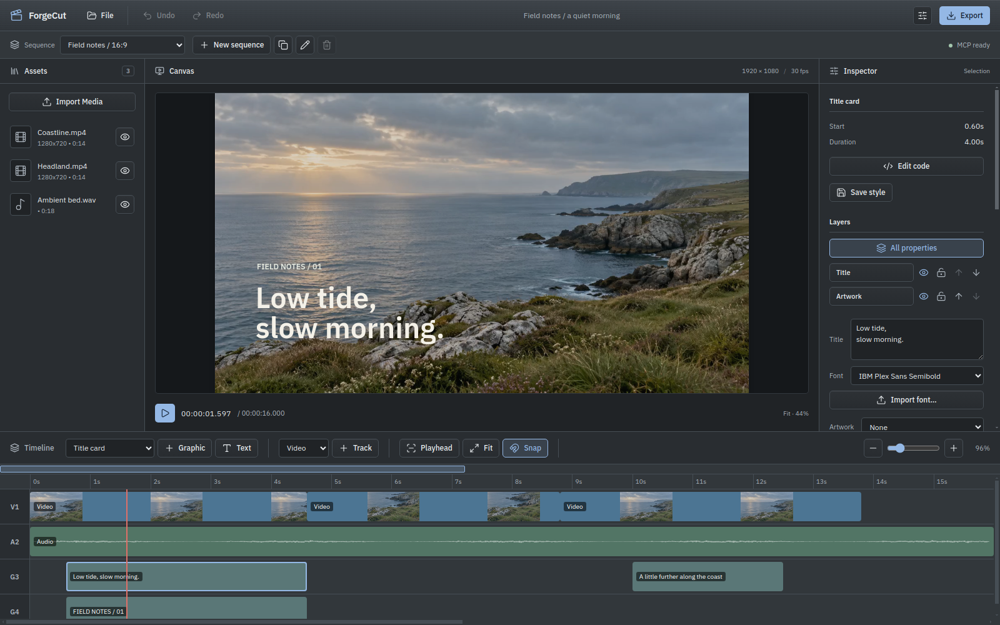

# ForgeCut

A focused desktop video editor for YouTube clips, trailers and editable graphics. Cut footage, shape the details and work alongside an MCP client while keeping the project in your hands.

[Project site](https://alexanderwanyoike.github.io/forgecut/) · [MCP setup](docs/mcp.md) · [Architecture decisions](docs/adr/)



A real editor capture with generated demo footage. [Light theme](site/images/editor-light.png) · [Code workspace](site/images/editor-code.png)

## What you can edit

- **Footage and sound:** source selections with notes, contact sheets, waveforms, short previews, multi-track cuts, trims, splits, music gain and fades.
- **Titles and artwork:** editable Remotion graphics, multiline text, portable fonts, images, colours, canvas placement and reusable project styles.
- **Graphic source:** a bundled Monaco workspace with typed source checking, recoverable drafts, isolated previews and explicit Apply.
- **Different formats:** named sequences and independent landscape or portrait variants, with timing sync when you choose it.
- **Delivery:** short review ranges, MP4 or WebM presets, saved serial export batches and portable collection of selected media, source, artwork, fonts and licence information.
- **The workspace:** aluminum light and dark themes, accent choices, keyboard controls and project undo/redo.

## Work with an MCP client

Keep ForgeCut open while talking to Codex or another MCP client. The agent reads and edits the same project as the visual editor, using guarded edit batches and the current project revision. Change the title, shot, music or crop yourself, then let the agent continue from the current state.

The adapter requires explicit attachment to a running editor. It does not launch ForgeCut or choose a project for you. See the [MCP guide](docs/mcp.md) for configuration, tools, limits and examples. Saved projects reopen and export without an agent connection.

## Download

Published installers: **v1.0.1**. The screenshots and feature descriptions above show the current development workspace; these older releases do not include the new MCP and graphics workflow.

| Linux                                                                                                                                                                                                                                      | Windows                                                                                                               | macOS                                                                                                                |
| ------------------------------------------------------------------------------------------------------------------------------------------------------------------------------------------------------------------------------------------ | --------------------------------------------------------------------------------------------------------------------- | -------------------------------------------------------------------------------------------------------------------- |
| [AppImage](https://github.com/alexanderwanyoike/forgecut/releases/download/v1.0.1/forgecut-1.0.1-linux-x86_64.AppImage)                                                                                                                    | [64-bit installer](https://github.com/alexanderwanyoike/forgecut/releases/download/v1.0.1/forgecut-1.0.1-win-x64.exe) | [Apple silicon](https://github.com/alexanderwanyoike/forgecut/releases/download/v1.0.1/forgecut-1.0.1-mac-arm64.dmg) |
| [Debian / Ubuntu](https://github.com/alexanderwanyoike/forgecut/releases/download/v1.0.1/forgecut-1.0.1-linux-amd64.deb), [Fedora](https://github.com/alexanderwanyoike/forgecut/releases/download/v1.0.1/forgecut-1.0.1-linux-x86_64.rpm) |                                                                                                                       | [Intel](https://github.com/alexanderwanyoike/forgecut/releases/download/v1.0.1/forgecut-1.0.1-mac-x64.dmg)           |

See the [release notes](https://github.com/alexanderwanyoike/forgecut/releases/tag/v1.0.1) and runtime requirements below.

## Requirements

The current editing workflow is on `dev`. Linux is the complete graphics baseline. macOS and Windows builds are checked in CI; native graphics rendering currently requires the supported Linux process boundary.

For Linux, install FFmpeg, ffprobe and bubblewrap, and use a desktop with an active systemd user session:

```bash
# Ubuntu / Debian
sudo apt-get install ffmpeg bubblewrap

# Fedora
sudo dnf install ffmpeg bubblewrap
```

Queued Linux exports run serially with CPU and memory limits. Full-resolution exports can take time on slower CPUs.

## Verification and formatting

```bash
yarn --cwd apps/forgecut_gui/ui test --no-file-parallelism
yarn --cwd apps/forgecut_gui/ui lint
yarn --cwd apps/forgecut_gui/ui format:check
yarn --cwd apps/forgecut_gui/ui analyze:architecture
```

On Linux with Xvfb and the graphics runtime prepared, exercise the real desktop workflow:

```bash
xvfb-run --auto-servernum yarn --cwd apps/forgecut_gui/ui verify:electron
```

Prettier covers source, configuration and documentation. Fallow reports the app's import graph, duplication and complexity. See the [analysis scope and findings](docs/code-quality.md) before interpreting its scores.

## Architecture

A React/Vite renderer talks to the Electron owner through a typed IPC contract. The owner holds project state, history and the serial job queue. MCP uses the same editing service.

- `apps/forgecut_gui/ui/electron/shared/`: project types, commands and typed results.
- `apps/forgecut_gui/ui/electron/domain/`: timeline, sequence and graphic rules.
- `apps/forgecut_gui/ui/electron/backend/`: editing commands, persistence, media processing and exports.
- `apps/forgecut_gui/ui/electron/mcp/`: the STDIO adapter and authenticated local editor bridge.
- `apps/forgecut_gui/ui/src/`: the visual editor, canvas, playback and code workspace.

FFmpeg and ffprobe run as child processes. Project source executes through the restricted graphics worker. The [architecture decisions](docs/adr/) record the boundaries, resource policy and supported integrations. The [implementation plan](docs/plans/forgecut-mcp-visual-code-editing.md) records the workflow and acceptance criteria.

## Keyboard controls

| Control               | Action                   |
| --------------------- | ------------------------ |
| Space                 | Play or pause            |
| S                     | Split at the playhead    |
| Delete / Backspace    | Delete the selected clip |
| Ctrl+Z                | Undo                     |
| Ctrl+Shift+Z / Ctrl+Y | Redo                     |
| Ctrl+= / Ctrl+-       | Zoom the timeline        |
| Ctrl+0                | Fit the timeline         |
| Drag a clip edge      | Trim                     |
| Drag a clip           | Move with snapping       |

Clicking a clip selects it. Use the ruler to move the playhead.

## Licence

ForgeCut's own code is [MIT-licensed](apps/forgecut_gui/ui/LICENSE). Third-party dependencies, including Remotion, retain their own licences and notices. The site includes IBM Plex Sans under its [font licence](site/fonts/OFL.txt).
