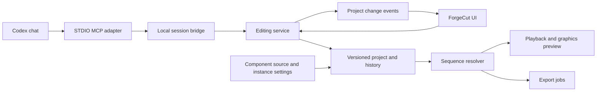

# ForgeCut MCP and graphics editing implementation plan

Status: Phase 0 feasibility and Phase 1 shared editing state are implemented and verified on Linux x64. Phase 1 changes the production editor, 23 October 2026. Phase 2 implementation and automated acceptance now pass on Linux: the live MCP bridge, guarded edits/history/files, shared editing context, status and cancellable import/frame jobs. The official SDK workflow assembles three generated source ranges, preserves a manual-service trim, reads current state, changes another range, undoes one agent batch, saves and reopens. Desktop human acceptance remains for stack review. Phase 3 is in progress: shared frame timing, timeline-positioned export and queued immutable exports are implemented. Playback, geometry/audio controls and explicit sequence ends remain.

ForgeCut will become the shared editing workspace for videos assembled with Codex. Codex stays in its existing chat and operates the running editor through MCP. The user can change footage, text, images, fonts, colours, positioning and timing directly, then ask Codex to continue from the current project.

The delivery order is: reliable project state, a live MCP editing loop, accurate playback and export, editable Remotion graphics, canvas manipulation, a Monaco code tab, and complete multi-format production workflows. Each phase ends with a usable demonstration and explicit acceptance checks.

## Agreed product behaviour

- The editor owns the project. UI commands and MCP commands use the same editing service.
- Manual edits remain authoritative. Stale agent changes fail without overwriting newer work.
- One logical editing request can be undone as one action.
- Graphics have Design, Properties and Code views. Design and Properties are the normal editing surfaces; Code provides deeper control.
- Graphics source and instance settings are separate. Moving an object updates project data rather than rewriting JSX.
- Supported graphic elements expose editable controls. Arbitrary React components do not automatically become fully editable canvas designs.
- Projects can be saved, reopened, edited and exported without a connected agent.
- Preview and export must agree on timing, placement, fonts, graphics and audio.
- The initial product is local and Linux-first, while retaining the repository's existing macOS and Windows checks.

Embedded chat, cloud collaboration, a full VS Code workbench, unrestricted package installation from the code tab, automatic interpretation of arbitrary JSX, advanced colour grading and a general keyframe editor are outside this initial delivery. Named animation presets and their exposed parameters are included.

## Starting foundations and gaps

The implementation started from these repository modules at the planning baseline:

| Area                     | Existing location                                                          | Implication                                                                                                                                                |
| ------------------------ | -------------------------------------------------------------------------- | ---------------------------------------------------------------------------------------------------------------------------------------------------------- |
| Domain and command types | `apps/forgecut_gui/ui/electron/shared/ipc-contract.ts`                     | Retain UUIDs, snake_case serialized fields, tagged variants and microsecond times                                                                          |
| Project and history      | `apps/forgecut_gui/ui/electron/backend/state.ts`                           | History snapshots currently cover only the timeline; mutations happen on live state before validation finishes                                             |
| Command dispatch         | `apps/forgecut_gui/ui/electron/backend/editing-service.ts` and `commands/` | Reuse domain operations, but remove transport dependence on Electron events and `WebContents`                                                              |
| Editing rules            | `apps/forgecut_gui/ui/electron/backend/timeline-ops.ts`                    | Preserve pure domain logic and strengthen invariants and rollback                                                                                          |
| Playback                 | `apps/forgecut_gui/ui/src/hooks/usePlayback.ts`                            | Add a sequence clock, complete audio playback and project-change subscriptions                                                                             |
| Graphics controls        | `apps/forgecut_gui/ui/src/components/Inspector.tsx` and `Preview.tsx`      | Extend the current basic text/image controls with typed properties and canvas selection                                                                    |
| Export                   | `apps/forgecut_gui/ui/electron/backend/exporter.ts`                        | Primary clips currently concatenate irrespective of gaps; additional video tracks use fixed PiP placement; every primary input is assumed to contain audio |
| Packaging                | `apps/forgecut_gui/ui/electron-builder.yml`                                | Explicitly package the MCP executable, component sources, compiler workers, fonts and rendering dependencies                                               |

At the planning baseline there was no MCP server, Remotion runtime or embedded code editor. Project loading cast parsed JSON without a versioned validation/migration boundary. Phase 1 subsequently added validated shared state and Phase 2 added MCP; later phases add graphics and code editing.

## Architecture and project contract



The Electron main process remains the single owner of the open project. A separate STDIO MCP adapter connects to that process over an OS-local socket, using a Unix socket on Linux/macOS and a named pipe on Windows. Protect the bridge with user-scoped access and a per-session secret. An MCP process must never create a second writable copy of the same open project.

The editing service accepts a session/project identity, an expected project revision, a request ID, a label and typed operations. It validates operations against a working copy and commits once. A successful batch creates one history entry, increments the revision and emits a project-change event. A failed batch changes neither project, revision nor history. Retrying a completed request ID returns the original result within a bounded deduplication window. A reused ID with different input is an error.

All project mutations, including source promotion, imports, settings, sequence changes and undo/redo, use this boundary. Probe/import work and compilation may happen outside the mutation queue, but commit must recheck project identity and revision. Undo/redo produce new revisions rather than reusing old revision numbers.

Selection, active sequence and playhead are session context rather than serialized creative content. They have their own context revision so playback does not invalidate every project edit. MCP reads their IDs once and targets explicit items; it must not reinterpret an old request against a newly selected object.

Version the `.forgecut` format. Retain one timeline initially, then migrate it into named sequences in the final phase. Introduce migrations incrementally, test every supported version and reject unknown future versions. Use relative references for project-owned source, fonts and artwork. Existing externally referenced recordings remain supported with a relink flow. Save project-owned files before atomically replacing the manifest, retain older content-addressed files while history references them, and detect missing assets on reopen.

## Phase overview

| Phase | Deliverable                                                       | Dependency                |
| ----- | ----------------------------------------------------------------- | ------------------------- |
| 0     | Verify integration choices and record architecture decisions      | None                      |
| 1     | Transactional project state, persistence and live UI refresh      | 0                         |
| 2     | Codex edits the running editor through MCP                        | 1                         |
| 3     | Playback, framing and export use consistent sequence semantics    | 1; prove MCP flow after 2 |
| 4     | Editable Remotion graphics and component packaging                | 0, 1, 3                   |
| 5     | Canvas editing of supported graphic layers                        | 4                         |
| 6     | Monaco source editing with safe source promotion                  | 4; validate with 5        |
| 7     | Footage review, sequences, format variants and production exports | 2 through 6               |

Implement in this order. Phase 2 proves the live editing loop early, but a production-ready clip is not claimed until Phase 3 passes. Phases 4 through 6 deliver the combined visual and code workflow.

## Phase 0 Integration decisions

**Outcome:** resolve the expensive integration questions before designing the full graphics editor.

Completed: a temporary prototype passed Linux packaged preview/Monaco checks, MCP STDIO discovery/tool execution, and a packaged transparent Remotion render composited with system FFmpeg. Custom source compiled and ran within the tested Electron preview and Bubblewrap export boundaries. Host resource denial, runaway-code termination and subsequent recovery checks passed. The editor baseline passed 92 tests and its build. [ADR 0001](../adr/0001-local-editing-integrations.md) records pinned versions, upstream patterns, resource measurements and public-release requirements. Production integration and other operating systems remain scoped to later phases.

The prototype and its standalone dependencies were removed before merging. Phase 0 retains the decisions and plan, with the minimalism rule in `AGENTS.md`. Later phases add maintained integration tests alongside production features; the historical feasibility checks are not the editor's current test suite.

Work:

- Pin compatible versions of Remotion, its Player and renderer, Monaco and the official MCP TypeScript SDK using Yarn. Check published stable APIs instead of copying an example from a different SDK generation.
- Record architecture decisions for the local bridge, graphics runtime, source/instance split and rendering path. Record dependencies, licences and required notices; check Remotion's applicable distribution terms before bundling it into the public app.
- Exercise one text/image component in packaged Electron: local fonts, frame seeking, property changes, transparent output and a short export over footage.
- Verify Monaco's TypeScript workers and a component compiler in packaged builds. The app currently loads production UI through `file://`; explicitly resolve worker/origin requirements rather than relying on Vite development behaviour.
- Check MKV recordings and codecs from the existing workflow. Choose derived playback proxies where Chromium cannot play an original; preserve original source references and timing for final export.
- Measure the graphics worker and encoding process together under a resource budget. Use one heavy job at a time initially; enforce a combined budget across subprocesses where the platform supports it.

Preferred rendering baseline: retain FFmpeg for footage assembly and audio; render graphics with Remotion in a separate worker. Use the same graphic components, inputs and frame mapping in Player and export. Evaluate a full Remotion sequence renderer only if the spike demonstrates a clear correctness or maintenance benefit within the measured budget. Freeze the decision before Phase 3's rendering work; do not maintain competing production render paths without a specific need.

Remotion Studio's `Interactive` APIs are useful references for exposed layers, but Studio interactivity is not assumed to be an embeddable Player editing API. Verify supported integration points and implement ForgeCut canvas controls over declared layer data as needed.

Acceptance: the packaged app previews and exports the sample correctly, the Monaco worker runs, required runtime assets resolve without the development server, and the architecture decisions include measured results and licence handling. If a chosen dependency fails these checks, resolve that specific choice before proceeding with dependent work.

## Phase 1 Reliable shared project state

Status: implemented in the production editor. See the [shared-state decision](../adr/0002-shared-editing-state.md) and [editing service contract](../editing-service.md). Validation includes transaction rollback, complete-project history, revision conflicts/retries, idempotent batches, async import/load races, legacy migration, invalid/future files, failed file replacement, stale thumbnails and live panel synchronization. The Electron smoke check exercises the real IPC path, title preview, undo/redo, retry deduplication and stale-revision rejection.

Verification on 23 October 2026: all 120 tests across 16 files pass; `yarn build` passes; `xvfb-run -a yarn verify:electron` passes with the actual Electron bridge and editor. Existing React act/media mock warnings remain in the suite, and the headless Electron run still reports a GPU initialization diagnostic. MCP is not connected to the production editor yet.

**Outcome:** any project change is validated, observable, reversible and persistable.

Work:

- Extract a transport-independent editing service and event sink. Keep Electron IPC as one adapter.
- Add runtime schemas for project loading and command input. Validate finite values, source bounds, positive durations, IDs, asset references, track compatibility and permitted property changes.
- Apply mutations on a copy, validate the result and commit atomically. Replace unrestricted property strings with typed patches for each item kind.
- Expand history to cover creative project state rather than only timeline data. Coalesce a drag, text-edit session or slider gesture into one undo entry. Bound history by retained data size as well as entry count.
- Add project/session identity, monotonic revisions, request deduplication and structured error results.
- Publish project-change events to the asset bin, timeline, Inspector and preview. Handle deleted selections and stale asynchronous Inspector results.
- Add versioned loading, atomic saves, recovery and missing-media reporting. Discard late import/probe results if their originating project is no longer current.

Acceptance and tests:

- A failed trim or a failed operation halfway through a batch leaves project data and history unchanged.
- A stale revision is rejected; rereading and submitting a new request succeeds.
- Importing assets, changing settings and editing items all update the UI and obey history rules.
- A project switch during an import cannot add assets to the new project.
- Legacy projects migrate, save and reopen; invalid/future formats fail with actionable errors and preserve the current open project.
- Interrupted saves retain a valid recoverable project.

Primary touchpoints: `state.ts`, `editing-service.ts`, `commands/`, `timeline-ops.ts`, `ipc-contract.ts`, renderer subscriptions and project-load tests.

## Phase 2 Live MCP editing

Status: in progress. The first slice provides authenticated instance discovery, explicit attachment, operation schemas, bounded reads and guarded live edit batches. See the [MCP setup and scope](../mcp.md) and [bridge decision](../adr/0003-live-mcp-bridge.md). Guarded history and save/reopen controls are also implemented. Shared editing context and visible MCP readiness/activity are implemented. Cancellable media jobs remain before Phase 2 acceptance.

**Outcome:** Codex here can inspect and edit a specific running ForgeCut session.

Work:

- Add the STDIO adapter and local session bridge. Explicitly list/select sessions; do not silently attach to whichever window was most recently focused.
- Expose a small typed tool surface, using the SDK for protocol handling. Do not expose a generic shell or arbitrary JavaScript execution tool.
- Return structured summaries, changed item IDs and revisions. Bound/paginate timeline and asset output; serve frames as images or bounded resources rather than embedding all media data into project responses.
- Keep reads inexpensive. Put import analysis, image extraction and rendering behind cancellable jobs that return IDs immediately.
- Add connection status and action labels in ForgeCut. Handle disconnect/reconnect and expired session identities cleanly.
- Document Yarn launch commands, Codex configuration and packaged executable locations. Supply configuration examples without changing the user's global Codex settings during implementation.

Initial tool groups:

| Group   | Proposed operations                                                     |
| ------- | ----------------------------------------------------------------------- |
| Session | List sessions, attach, read capabilities and editing context            |
| Project | Read summary, assets, timeline ranges and individual items              |
| Edits   | Apply a validated operation batch with expected revision and request ID |
| History | Undo/redo with identity and revision checks                             |
| Media   | Import sources; request bounded source frames                           |
| Jobs    | Start, inspect and cancel supported jobs                                |

Extend these groups with graphics and code operations in later phases. Publish structured capability/schema information so tools only advertise supported behaviour.

Acceptance: Codex assembles three source ranges; the user trims one manually; Codex reads the result and changes another. The user undoes the agent batch in one action, saves and reopens. Test the MCP adapter against a real local bridge, including stale edits, retries, disconnects, wrong-session requests and invalid inputs.

## Phase 3 Consistent playback and export

**Outcome:** the timeline describes what is actually heard and rendered.

Work:

- Introduce a pure sequence resolver for active items, gaps, source times, geometry, stacking and audio envelopes. Share it between preview planning and export compilation.
- Retain integer microseconds in saved data. Define conversion and rounding at project frame boundaries, use half-open item intervals and handle source/project frame-rate differences without cumulative drift.
- Make playback cross cuts and gaps using a sequence clock. Mix the music track and source audio during preview; seeking and pausing must affect all active media together.
- Respect actual timeline positions in export. Generate gap frames/silence and support silent video inputs, overlays without underlying footage and explicit sequence ends.
- Add crop/fit, position, size, opacity and stacking controls consistently to video/graphics where supported. Replace fixed PiP geometry with item data.
- Add source-audio gain/mute and editable fades; retain existing audio-volume settings. Make an uninterrupted music bed independent of picture cuts.
- Use immutable project snapshots for export jobs so editing during export cannot change the output halfway through.
- Add serial job execution, cancellation, subprocess cleanup, progress, temporary outputs and atomic completion. Apply the resource policy proven in Phase 0.

Acceptance: a small synthetic fixture covers a leading gap, two cuts, a silent video, overlapping graphics, a title-only ending and continuous music. Check rendered frames, frame counts, duration, crop and audio landmarks against resolver expectations and the preview. Add real FFmpeg integration checks on Linux CI with generated media; existing filter-string tests alone are insufficient. Seeking across boundaries and editing during export must behave predictably.

## Phase 4 Editable Remotion components

**Outcome:** graphics stay editable after Codex creates them.

Work:

- Add a tagged graphics item referencing a component definition/version plus instance properties, duration and placement. Keep existing variants readable through migrations or adapters.
- Store component source, property schemas, editable layer descriptors, asset/font dependencies and content hashes with the project. Use stable IDs for editable layers and properties.
- Separate per-instance content and transforms from component implementation. Property controls declare type, label, default and useful constraints. Reject invalid properties before changing active state.
- Build initial components for a title card, image/brand overlay, lower third and ending card. Expose text, image choice, font, size, colour, alignment, opacity and applicable animation settings.
- Build typed Properties controls and asset/font pickers. Font files and their licence metadata travel with portable project assets; report missing fonts instead of silently changing the result.
- Integrate Player with the sequence clock and the rendering path chosen in Phase 0. Use identical component versions, frame inputs and font files for preview and export. Invalidate graphics caches on source, settings, assets, fonts, dimensions or runtime changes.
- Extend MCP with component discovery, schemas, instance creation and typed property patches.

Acceptance: reproduce one Octane card and ending card using original artwork/fonts as project assets. Change wording, font, image and colour through both UI and MCP; undo, save, reopen and export. Verify the selected component version and exact inputs are retained. A full-screen card must work without hidden placeholder footage underneath.

## Phase 5 Canvas editing

**Outcome:** the user can directly manipulate supported graphic layers.

Work:

- Add hit testing, selection outlines, drag/resize handles, keyboard nudging, alignment guides and a layer list with ordering, visibility and locking.
- Map pointer coordinates into composition coordinates independently of preview zoom, window size and display scale. Apply parent transforms correctly for nested editable elements.
- Support selecting text for editing and replacing images from the asset bin. Keep selection, Properties and timeline focus in sync.
- Define editable bounds, anchor points and supported transforms in layer descriptors. Layout-driven components may expose a group or layout controls rather than unrestricted child positioning.
- Treat dragging as transient preview state until commit, with escape-to-cancel and one history entry. Cancel or reject the gesture if its base project revision changes underneath it.
- Keep entrance/exit animation relative to stable object placement. Dragging an animated title must not replace its animation curve.
- Let MCP inspect stable selected-layer IDs and edit the same properties.

Acceptance: resize the preview, move the Octane title and swap its artwork without drift. Repeat at different display scales and in portrait dimensions. Confirm lock/order behaviour, nested hit testing, keyboard operation, cancellation and one-step undo. Visual edits must preserve component source hashes and unrelated properties.

## Phase 6 Monaco code tab

**Outcome:** custom graphics can be changed in source without losing ordinary visual editing.

Work:

- Embed Monaco lazily in a Code tab or split view. Wire TSX syntax, completion, diagnostics, component schema types, local imports and source navigation. Provide explicit Apply and Revert actions.
- Use a defined component file workspace and approved dependency set. New external packages are added through the normal repository/dependency workflow, not arbitrary installs from project code.
- Keep source drafts separate from active source. Compile drafts in a worker/process and preview them in an isolated graphics surface without the application preload bridge or Node access. Restrict asset access to project resources and terminate runaway compilation/render work.
- Promote a validated component version atomically after compilation and runtime checks. Failed drafts preserve the last working project and preview, with diagnostics linked to source lines.
- Preserve current instance values when the new schema is compatible. Require explicit migration mappings for renamed/removed layer IDs or properties; never silently reset user positioning or text.
- Default source edits to a project-local component copy. Show affected instances before an explicit shared-component update; support forking one instance when the user wants a unique design.
- Distinguish Monaco draft undo from project undo. Applying a source version becomes one project history action; project undo restores the previous active version and affected instance data. Persist recoverable drafts separately.
- Extend MCP with source reads, draft writes, diagnostics and source-promotion operations using the same revision guards. Compilation jobs do not lock out manual editing, but promotion rechecks the base revision.

Acceptance: change the title animation in Code, apply it, then adjust its position visually. Introduce a syntax error and a runtime error; both retain the last working output. Test a schema rename, undo/redo of source promotion, project reopen, draft recovery and a shared-component change. Test nonterminating component code and attempted access to the app bridge in the isolated execution surface.

## Phase 7 Complete video production workflows

**Outcome:** support the footage-to-trailer-and-clips process demonstrated by Fallspark and Octane.

Work:

- Add named sequences for trailers and standalone clips with shared project assets. Migrate the original timeline into one default sequence and add sequence-scoped selection, history targets and MCP reads.
- Add source selections with in/out points, thumbnails, notes and rationale. Generate contact sheets, waveform data and short previews as bounded cached jobs. Automated transcription, beat analysis and highlight detection are follow-up capabilities, not prerequisites for manual/Codex selections.
- Add explicit landscape/portrait variants. Copy a sequence initially and retain origin IDs for comparison; framing and timing edits remain independent unless the user invokes a specific sync operation. Do not silently propagate layout changes between formats.
- Add project style presets for typography, colours, cards and endings, with instance overrides. Keep each game's own visual identity and allow restrained copy.
- Provide source/music/font provenance and credits fields. Keep continuous music, narration and game audio as editable tracks.
- Add short-range review exports, format export presets and a serial batch queue. Persist queue metadata, clean partial outputs, and define restart/resume behaviour at job boundaries.
- Add portable project collection for source code, artwork, fonts and selected media, plus relinking for recordings intentionally kept external. Keep private source footage out of the repository and use generated fixtures in CI.

Acceptance: reconstruct the existing Octane trailer plus a standalone clip in landscape and portrait. Manually replace a shot, change a card, swap music and alter the portrait crop. Ask Codex to continue from those edits. Save, close, reopen without Codex, export all four deliverables and check frames, timing, audio continuity and dependency resolution. Reopen a collected project from a different directory.

## Delivery and verification rules

Each phase is a sequence of focused changes rather than one large commit. Keep a failing regression test in its own commit, its fix in a separate commit, and subsequent refactoring separate. For new behaviour, split changes into the smallest coherent domain, transport and UI slices that remain reviewable. Do not introduce unrelated cleanup.

Use Yarn for dependency management and all JavaScript project commands. Run focused tests while implementing, then the relevant existing checks:

```sh
yarn --cwd apps/forgecut_gui/ui test
yarn --cwd apps/forgecut_gui/ui build
yarn --cwd apps/forgecut_gui/ui verify:electron
```

Run the startup check under the existing Linux Xvfb setup where required. Add generated-media render checks and packaged MCP/Monaco/Remotion smoke tests as those features arrive. Preserve the existing cross-platform test matrix. Include manual listening and motion review for the Octane acceptance workflow; numerical media checks do not establish editorial quality.

Every implementation PR follows the repository's Background, Tasks and Tested description structure. Record the applicable upstream pattern and licence when introducing an integration. Architecture decisions from Phase 0 should explain the chosen approach, alternatives actually evaluated and measurements that determined the result.

The first implementation slice is Phase 1's transaction rollback guarantee, after the Phase 0 decisions: a regression demonstrating a failed mutation leaking state, followed by the isolated fix. The first user-facing milestone is Phase 2's live editing loop. The combined visual/code milestone completes after Phase 6; Phase 7 expands it into the complete production workflow.

## Upstream patterns and references

- [Codex MCP support](https://learn.chatgpt.com/docs/extend/mcp?surface=cli): supported local transport and host configuration. Use STDIO between Codex and the adapter; the adapter-to-editor bridge is a ForgeCut implementation detail.
- [Official MCP TypeScript SDK](https://github.com/modelcontextprotocol/typescript-sdk): use maintained server, schema and transport facilities rather than a custom MCP implementation. Preserve the notices applicable to the pinned release; the upstream repository documents an Apache-2.0/MIT licensing transition in its [licence](https://github.com/modelcontextprotocol/typescript-sdk/blob/main/LICENSE).
- [Remotion parameterised videos](https://www.remotion.dev/docs/parameterized-rendering): component inputs and schemas inform the source/instance settings split. [Player](https://www.remotion.dev/docs/player/player) supplies the graphics preview primitive.
- [Remotion Elements](https://www.remotion.dev/docs/elements) and [Interactive](https://www.remotion.dev/docs/interactive): reference exposed editable layers and animation/placement separation. Studio features are not assumed to be a public editing SDK for Player.
- [Remotion licence](https://github.com/remotion-dev/remotion/blob/main/LICENSE.md): check the exact pinned release and distribution use before shipping; do not treat Remotion as an MIT dependency.
- [Monaco Editor](https://github.com/microsoft/monaco-editor): embedded editor models, TypeScript services and worker integration. Monaco is MIT licensed and is an editor component rather than the complete VS Code workbench.
- Existing ForgeCut pure timeline operations, typed IPC contract and FFmpeg child-process architecture remain the local implementation patterns. Extend them through a shared service instead of creating separate agent-only editing logic.
